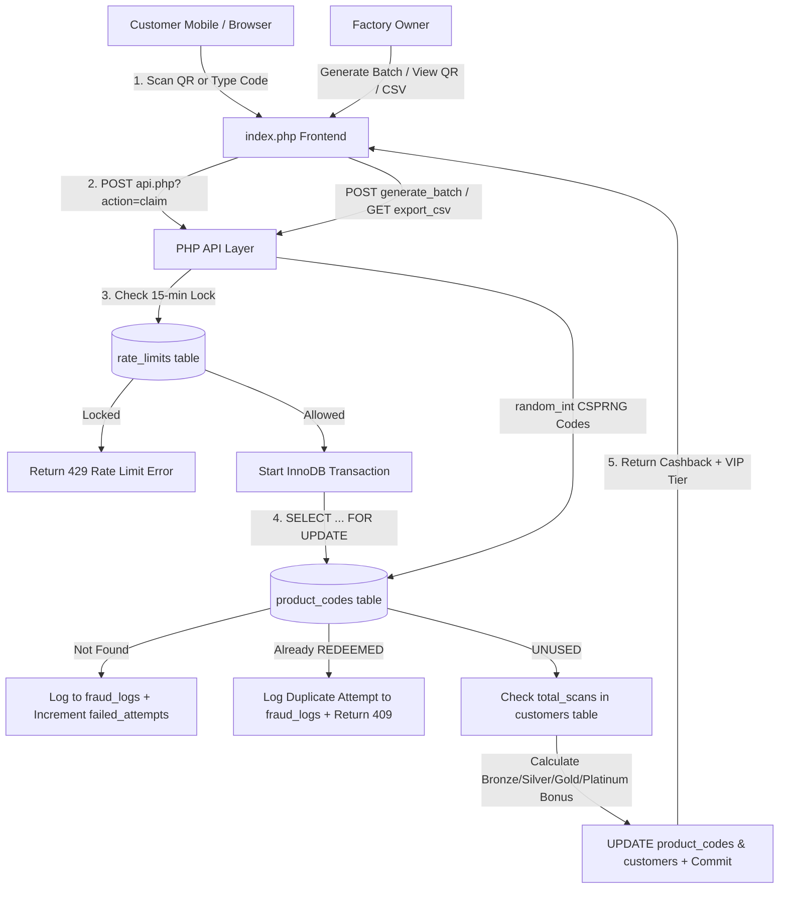

# System Architecture

## 1. Tech Stack & Rationale
- **PHP 8+ (PDO):** Widely supported on local stacks (XAMPP) and budget shared hosting, zero build-step required, and native `PDO` prepared statements prevent SQL injection.
- **MySQL / MariaDB (InnoDB):** Provides ACID transactions and row-level locking (`SELECT ... FOR UPDATE`), which is critical for preventing race-condition double redemptions.
- **Tailwind CSS + Vanilla JS (`fetch`):** Keeps the frontend lightweight with no `npm` build pipeline while still delivering a responsive mobile-first UI.
- **`html5-qrcode` & `qrcodejs`:** Enables real camera/image QR scanning and downloadable PNG QR generation directly in the browser.

## 2. Data Model (MySQL Schema)
- **`batches`**: Tracks factory print runs (`id`, `batch_name`, `cashback_amount`, `quantity`, `created_at`).
- **`customers`**: Tracks repeat-purchase loyalty per phone (`phone` PK, `total_scans`, `total_earned`, `updated_at`) to unlock Silver (10+), Gold (50+), and Platinum VIP (100+ scans = 2x cashback).
- **`product_codes`**: Stores every unique box code (`id`, `batch_id` FK, `code` UNIQUE, `cashback_amount`, `bonus_amount`, `final_payout`, `status` [`UNUSED`|`REDEEMED`], `redeemed_phone`, `redeemed_upi`, `redeemed_at`).
- **`fraud_logs`**: Audit trail of blocked duplicate redemptions and invalid code guesses (`id`, `code_attempted`, `phone`, `ip_address`, `reason`, `created_at`).
- **`rate_limits`**: Tracks consecutive failed attempts per `IP|Phone` (`id`, `identifier` UNIQUE, `failed_attempts`, `locked_until`).

## 3. Architecture & Redemption Flow Diagram

